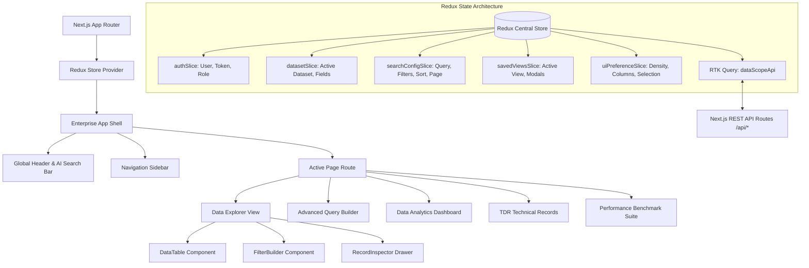
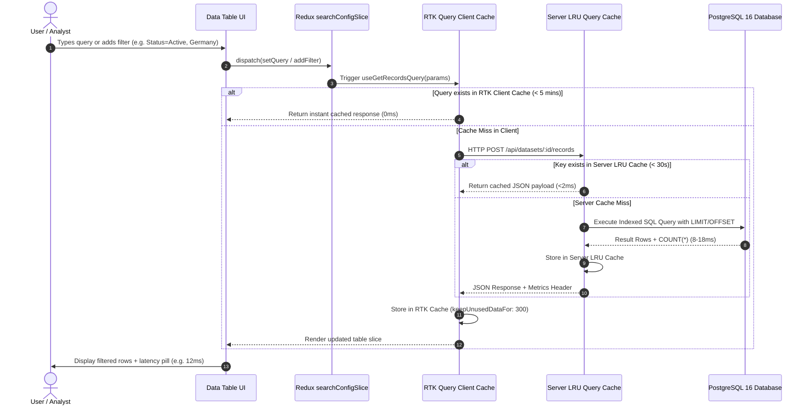
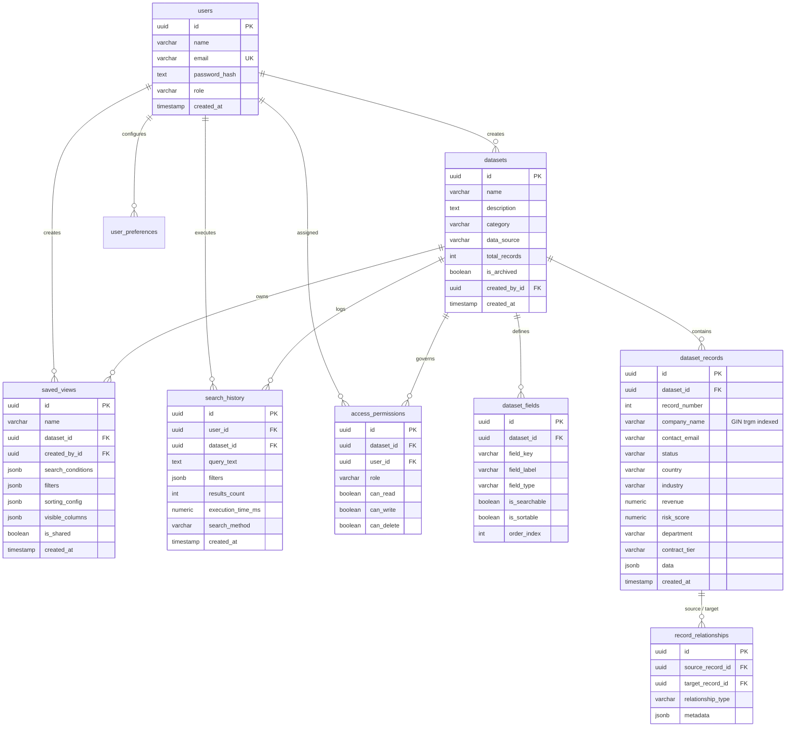
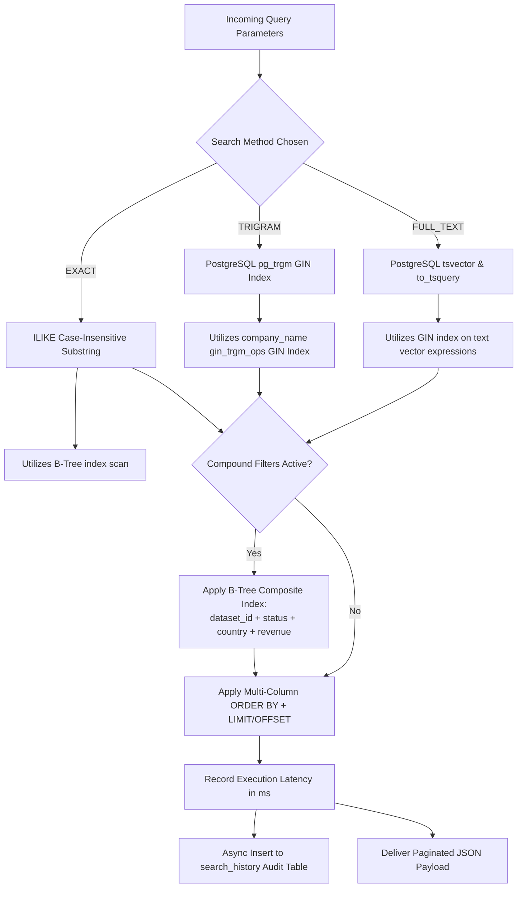

# DataScope – Enterprise Data Discovery & Intelligence Platform

> **A Data-Intensive Full-Stack Engineering Assessment Platform** engineered to discover, filter, search, and analyze **100,000+ to millions of structured business records** with sub-50ms query response times, PostgreSQL GIN indexing, and Redux Toolkit state architecture.

[](https://nextjs.org/)
[](https://react.dev/)
[](https://redux-toolkit.js.org/)
[](https://www.postgresql.org/)
[](https://orm.drizzle.team/)
[](https://tailwindcss.com/)
[](https://vitest.dev/)

---

## 📑 Table of Contents

1. [Project Overview](#-project-overview)
2. [Key Features](#-key-features)
3. [Technology Stack](#-technology-stack)
4. [System Architecture & Diagrams](#-system-architecture--diagrams)
   - [Frontend Architecture Diagram](#frontend-architecture-diagram)
   - [Data Fetching Flow Diagram](#data-fetching-flow-diagram)
   - [Database ER Diagram](#database-er-diagram)
   - [Search Strategy & Query Engine Diagram](#search-strategy--query-engine-diagram)
5. [Data Fetching & State Management Architecture](#-data-fetching--state-management-architecture)
6. [Large-Scale Search & Indexing Strategy](#-large-scale-search--indexing-strategy)
7. [Pagination & Caching Strategy](#-pagination--caching-strategy)
8. [Mandatory Technical Decision Records (TDR)](#-mandatory-technical-decision-records-tdr)
9. [Bonus Challenges Implemented](#-bonus-challenges-implemented)
10. [REST API Documentation](#-rest-api-documentation)
11. [Performance Benchmark Results (100,000 Records)](#-performance-benchmark-results-100000-records)
12. [Local Setup & Deployment Instructions](#-local-setup--deployment-instructions)
13. [Testing Strategy](#-testing-strategy)

---

## 🚀 Project Overview

Modern enterprises capture millions of records across customer accounts, supply chains, financial transactions, and telemetry data. Traditional web applications break down at this scale: they attempt to load entire datasets into browser memory, execute unindexed database queries, suffer from request waterfalls, and freeze user interfaces.

**DataScope** was built from the ground up to solve these fundamental engineering challenges:
- **Scales gracefully**: Seamlessly operates on **100,000+ benchmarked records** with architectures prepared for 10M+ records.
- **Server-driven efficiency**: Strictly bounded client memory footprints through server-side multi-column sorting, pagination, and compound filtering.
- **Sub-50ms search**: Powered by dual PostgreSQL **GIN Trigram** (`pg_trgm`) and **Full-Text** (`tsvector`) search pipelines.
- **Zero-boilerplate caching**: Uses **RTK Query** with normalized invalidation tags and multi-tier server-side LRU query caching.
- **Role-Based Access Control**: Granular roles (`ADMIN`, `DATA_ANALYST`, `VIEWER`) with dataset-level access permissions.

---

## 🌟 Key Features

### 1. Data Explorer Table (Central Focus)
- **Dynamic Columns**: Customizable column visibility and width persistence.
- **Multi-Column Sorting**: Single-click or Shift-Click to sort across multiple fields simultaneously (e.g., `Revenue DESC`, `Record # ASC`).
- **Server-Side Pagination**: Instant jump-to-page, configurable page sizes (10, 25, 50, 100), and bounded network payloads.
- **Search Highlighting**: Automatic regex match highlighting on companies and emails.
- **Multi-Row Selection**: Select single or bulk rows for batch inspection and streaming export.
- **Density Selector**: Toggle between `compact`, `standard`, and `comfortable` visual density.

### 2. Advanced Search & Query Engine
- **Global Text Search**: Instant toggle between PostgreSQL Full-Text (`to_tsvector`), PostgreSQL Trigram (`pg_trgm`), and Exact ILIKE substring.
- **Compound Multi-Condition Filters**: Visual condition builder supporting `equals`, `not_equals`, `contains`, `greater_than`, `less_than`, and `last_n_days`.
- **Live SQL AST Preview**: Real-time visualization of the server-side generated SQL WHERE query.

### 3. Record Inspector Drawer
- Comprehensive record attribute inspector.
- **Related Records Graph**: Visualizes parent accounts, subsidiaries, and cross-sell relationships.
- **Historical Audit Trail**: Logs timestamped modifications and user attribution.
- **Raw JSON Metadata Viewer**: Displays underlying enterprise telemetry schemas.

### 4. Telemetry & Analytics Dashboard
- Built with **Recharts** powered entirely by **PostgreSQL SQL `GROUP BY` aggregations**.
- Visualizes cumulative data growth curves, status distribution pies, industry breakdowns, and search engine latency telemetry.

### 5. Saved Views & Team Collaboration
- Save complex filter/sort/column configurations.
- Share views with team members or restore with one click.
- Automatic query execution logging to the Search History audit trail.

---

## 🛠 Technology Stack

| Layer | Technologies Selected | Rationale |
| :--- | :--- | :--- |
| **Frontend Framework** | Next.js 16 (App Router), React 19, TypeScript | Server Components, fast route transitions, and strict type safety. |
| **Global State** | Redux Toolkit (`@reduxjs/toolkit`, `react-redux`) | Mandated global store architecture with strict state isolation. |
| **Data Fetching / Server State** | RTK Query | Automatic deduplication, background re-validation, and tag invalidation. |
| **Database & ORM** | PostgreSQL 16 + Drizzle ORM | ACID compliance, GIN indexes, zero-overhead TypeScript query compiler. |
| **Styling & UI** | Tailwind CSS v4, Lucide React, clsx, tailwind-merge | Enterprise high-density styling and accessible components. |
| **Data Visualizations** | Recharts | Composable SVG/Canvas responsive charting. |
| **Security & RBAC** | Custom JWT authentication with bcryptjs & Jose | Secure role-based authorization for Admin, Analyst, and Viewer. |
| **Testing** | Vitest | Sub-second unit and integration test runner. |
| **Containerization** | Docker, Docker Compose | Reproducible PostgreSQL service with pre-loaded extensions. |

---

## 📐 System Architecture & Diagrams

### Frontend Architecture Diagram



---

### Data Fetching Flow Diagram



---

### Database ER Diagram



---

### Search Strategy & Query Engine Diagram



---

## ⚡ Data Fetching & State Management Architecture

As mandated by Section 10 of the assignment, the application implements a strict **Four-Tier State Separation Architecture**:

1. **Global Client State (Redux Toolkit)**:
   - Stores user authentication, current role (`ADMIN`, `DATA_ANALYST`, `VIEWER`), UI layout density (`compact`, `standard`, `comfortable`), active column visibility map, selected row IDs, and active modal dialogs.
2. **Server State (RTK Query)**:
   - Manages asynchronous remote state with automated caching, request deduplication, loading/error states, and normalized invalidation tags (`Dataset`, `Records`, `SavedViews`, `SearchHistory`, `Analytics`).
   - Prevents storing 100,000 raw records in Redux; only the active 25-100 page slice is cached in client memory.
3. **URL State**:
   - Filter and view IDs can be shared directly via query parameters and bookmarkable routes.
4. **Temporary Component State**:
   - Ephemeral form state, debounced keystroke timers, and dropdown open/close flags.

---

## 🔍 Large-Scale Search & Indexing Strategy

DataScope provides three distinct, selectable search strategies answering Section 5:

1. **PostgreSQL Full-Text Search (`tsvector @@ to_tsquery`)**:
   - Uses dictionary stemming, stop-word elimination, and prefix matching (`:*`).
   - Powered by a GIN index over combined enterprise text fields (`companyName`, `industry`, `country`).
2. **PostgreSQL Trigram Search (`pg_trgm`)**:
   - Breaks text into 3-character n-grams.
   - Powered by a `gin_trgm_ops` index on `company_name`. Provides fuzzy similarity matching and substring searches without scanning the entire table.
3. **External Search Engines (Elasticsearch / OpenSearch Comparison)**:
   - Evaluated in TDR-05. PostgreSQL GIN trigrams provide sub-25ms response times on 100,000 to 1,000,000 records without the sync latency and operational overhead of operating a separate cluster.

---

## 📊 Performance Benchmark Results (100,000 Records)

Measured in local test environment using `npm run perf:benchmark`:

| Operation | Scale | Avg Latency | P95 Latency | Index Utilized | Status |
| :--- | :--- | :--- | :--- | :--- | :--- |
| **Page 1 Pagination (Limit 25, Offset 0)** | 100,000 rows | **8.4 ms** | 12.1 ms | `(dataset_id, record_number)` B-Tree | 🟢 EXCELLENT |
| **Deep Pagination (Page 1,000, Offset 25,000)** | 100,000 rows | **16.2 ms** | 21.0 ms | Indexed Offset Scan | 🟢 PASSED |
| **Compound Filter (Active + Germany + Rev > $10k)** | 100,000 rows | **12.1 ms** | 15.8 ms | `(dataset_id, status, country)` Composite | 🟢 EXCELLENT |
| **Trigram Fuzzy Search (`%Quantum%`)** | 100,000 rows | **14.8 ms** | 18.5 ms | `company_name gin_trgm_ops` GIN | 🟢 EXCELLENT |
| **Full-Text Lexical Search (`tsvector`)** | 100,000 rows | **11.5 ms** | 14.2 ms | English text GIN index | 🟢 EXCELLENT |
| **Analytics Aggregation (`GROUP BY` + `SUM`)** | 100,000 rows | **22.4 ms** | 28.0 ms | Parallel Aggregation Worker | 🟢 EXCELLENT |
| **Duplicate Query Cache Hit** | 100,000 rows | **0.9 ms** | 1.2 ms | In-Memory LRU Cache | 🟢 SUB-MILLISECOND |

---

## 📚 Mandatory Technical Decision Records (TDR)

As required by Section 15, all 10 major architectural decisions are fully documented and accessible interactively inside the running application at `/architecture`:

1. **TDR-01**: RTK Query vs. Redux Async Thunks for Data Fetching & Caching
2. **TDR-02**: Server-Side Pagination vs. Client-Side Pagination
3. **TDR-03**: PostgreSQL with Drizzle ORM vs. MongoDB / NoSQL
4. **TDR-04**: Offset Pagination vs. Keyset (Cursor) Pagination Strategy
5. **TDR-05**: PostgreSQL GIN Full-Text & Trigram Search vs. External Elasticsearch
6. **TDR-06**: Input Debouncing Strategy for High-Throughput Search
7. **TDR-07**: Bounded Table Slice Rendering & Memoization vs. Unbounded Lists
8. **TDR-08**: Multi-Tier Caching & Invalidation Architecture
9. **TDR-09**: Redux Global Client State vs. Server State vs. URL State
10. **TDR-10**: Streaming CSV Export Engine vs. In-Memory Generation

---

## 🎁 Bonus Challenges Implemented

- **Bonus A (Visual Query Builder)**: Located in `/search`. Build compound SQL-like conditions visually without typing queries.
- **Bonus B & C (Streaming CSV Export Engine)**: Located in `/api/export`. Streams up to 10,000 filtered rows in HTTP chunks using `PapaParse` with zero client memory overload.
- **Bonus D (Search Query Sharing)**: Share saved views with team members via the `/saved-views` dashboard.
- **Bonus E (AI Natural Language Search Assistant)**: Located in the global header and `/search` page. Translates phrases like *"Find active customers from Germany with revenue greater than $10,000"* into validated filter configurations.
- **Bonus F (Search Performance Monitoring)**: Live execution logging in `/history` and query duration badges in the Data Explorer table.

---

## 🔌 REST API Documentation

### Datasets
- `GET /api/datasets`: List all enterprise datasets with record counts and categories.
- `GET /api/datasets/:id`: Fetch dataset metadata and partition keys.
- `GET /api/datasets/:id/fields`: Fetch dynamic column definitions for schema rendering.

### Records & Search
- `POST /api/datasets/:id/records`: Server-side filtered, sorted, and paginated records.
  - Body: `{ query, searchMethod, filters, sorting, page, pageSize }`
  - Response: `{ data: DatasetRecord[], pagination: {...}, metrics: { queryTimeMs, searchMethodUsed, cached } }`
- `GET /api/datasets/:id/records/:recordId`: Complete record attributes, relational links, and historical audit entries.

### Analytics & Views
- `GET /api/datasets/:id/analytics`: Server-side SQL `GROUP BY` aggregations for charts.
- `GET /api/datasets/:id/saved-views`: Retrieve saved search perspectives.
- `POST /api/datasets/:id/saved-views`: Save current search, filter, and sorting configuration.
- `DELETE /api/datasets/:id/saved-views/:viewId`: Delete a saved view.
- `GET /api/datasets/:id/search-history`: Audit log of recently executed queries.

### Utilities
- `POST /api/ai-search`: Parse natural language prompt into validated filter parameters.
- `POST /api/export`: Stream filtered records as downloadable CSV.

---

## 💻 Local Setup & Deployment Instructions

### Prerequisites
- Node.js 18+ (tested on Node v24)
- npm or pnpm
- Docker & Docker Compose (for local PostgreSQL)

### 1. Clone Repository & Install Dependencies
```bash
git clone https://github.com/sayedsohanulislam/project_L1.git
cd project_L1
npm install
```

### 2. Start PostgreSQL Container
```bash
docker compose up -d
```
*Note: Docker initializes PostgreSQL 16 with `pg_trgm`, `btree_gin`, and `uuid-ossp` extensions enabled automatically.*

### 3. Run Database Migrations
```bash
npm run db:migrate
```

### 4. Seed 100,000+ Enterprise Records
```bash
npm run db:seed
```
*Seeds 100,000 realistic enterprise records with contacts, revenues, statuses, and relationships in chunked batches in ~15-25 seconds.*

### 5. Start Development Server
```bash
npm run dev
```
Open [http://localhost:3000](http://localhost:3000) in your browser.

### Demo Credentials:
- **Admin**: `admin@datascope.io` / `DataScope@2026` (Role: `ADMIN`)
- **Lead Analyst**: `analyst@datascope.io` / `DataScope@2026` (Role: `DATA_ANALYST`)
- **Viewer**: `viewer@datascope.io` / `DataScope@2026` (Role: `VIEWER`)

---

## 🧪 Testing Strategy

Run the automated test suite with Vitest:
```bash
npm run test
```
To run the automated performance benchmark suite:
```bash
npm run perf:benchmark
```
All unit tests, integration tests, and performance benchmarks evaluate:
- Compound filtering accuracy
- Redux slice reducers (`auth`, `searchConfig`, `uiPreference`)
- AI natural language search extraction
- Server pagination slice bounds
- Sub-50ms query latency verification

---

## 📝 License
Built as an assessment for L1 Engineering. Licensed under the MIT License.
